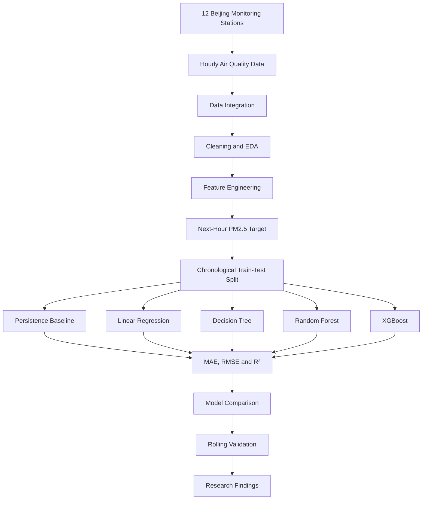
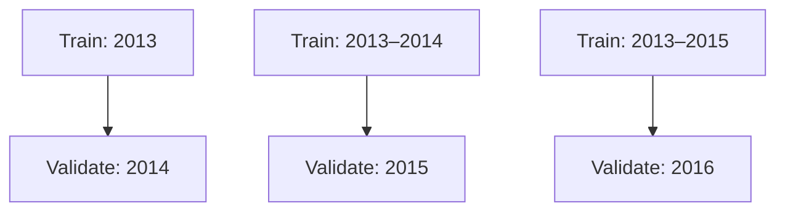

<div align="center">

<picture>
  <source media="(prefers-color-scheme: dark)"
    srcset="https://readme-typing-svg.demolab.com?font=Fira+Code&weight=700&size=25&duration=3000&pause=1000&color=36BCF7&center=true&vCenter=true&width=950&lines=Urban+PM2.5+Concentration+Prediction;Machine+Learning+%7C+Air+Quality;Time-Series+Forecasting+%7C+Environmental+AI" />
  <source media="(prefers-color-scheme: light)"
    srcset="https://readme-typing-svg.demolab.com?font=Fira+Code&weight=700&size=25&duration=3000&pause=1000&color=1764A0&center=true&vCenter=true&width=950&lines=Urban+PM2.5+Concentration+Prediction;Machine+Learning+%7C+Air+Quality;Time-Series+Forecasting+%7C+Environmental+AI" />
  
</picture>

### 🌍 Machine Learning-Based Prediction of Urban PM2.5 Concentration

**One-Hour-Ahead Air Quality Forecasting Using Meteorological and Atmospheric Pollutant Data**

*Environmental Data Science • Machine Learning • Time-Series Forecasting*

<br/>


<br/>


</div>

---

## 📖 Project Overview

Air pollution is a major environmental
and public health concern, particularly
in densely populated urban environments.

**PM2.5** refers to fine particulate matter
with an aerodynamic diameter of
2.5 micrometers or less.

Forecasting PM2.5 concentrations can
support research into changing air
quality conditions and short-term
pollution patterns.

This project investigates
**one-hour-ahead PM2.5 forecasting**
using machine learning techniques
and historical atmospheric observations.

The research uses the
**Beijing Multi-Site Air Quality Dataset**,
which contains hourly observations
from 12 monitoring stations between
March 2013 and February 2017.

The framework incorporates:

- Exploratory Data Analysis (EDA)
- Missing-value handling
- Data integration and preprocessing
- Meteorological and pollutant features
- Time-based feature engineering
- Lag-based forecasting
- Persistence baseline evaluation
- Supervised regression models
- Chronological train-test splitting
- Expanding-window rolling validation
- Model comparison and visualization

The study emphasizes an important
research question:

**Do increasingly complex machine
learning models necessarily improve
short-term PM2.5 forecasting accuracy?**

The experimental findings suggest
that simpler approaches can remain
highly competitive for one-hour-ahead
forecasting.

---

## 🎯 Research Objectives

The project aims to:

1. Analyze historical urban air pollution data.
2. Investigate relationships between PM2.5,
   other pollutants, and meteorological conditions.
3. Develop a next-hour PM2.5 forecasting target.
4. Establish a persistence forecasting baseline.
5. Implement and compare regression algorithms.
6. Preserve temporal ordering during evaluation.
7. Measure forecasting accuracy using MAE,
   RMSE, and R².
8. Assess Linear Regression using
   expanding-window rolling validation.
9. Investigate the relationship between
   model complexity and forecasting performance.

---

## 🗂️ Dataset Information

### Beijing Multi-Site Air Quality Dataset

**Source:** UCI Machine Learning Repository

[Access the Original Dataset](https://archive.ics.uci.edu/dataset/501/beijing+multi+site+air+quality+data)

| Property | Description |
|:---|:---|
| Dataset | Beijing Multi-Site Air Quality |
| Location | Beijing, China |
| Monitoring Stations | 12 |
| Observation Frequency | Hourly |
| Time Period | March 2013 – February 2017 |
| Original Records | Approximately 420,768 |
| Prediction Target | Next-hour PM2.5 |
| Forecasting Horizon | 1 hour |
| Task Type | Supervised Regression |

### Atmospheric Pollutant Features

The dataset includes:

| Feature | Description |
|:---|:---|
| `PM2.5` | Fine particulate matter concentration |
| `PM10` | Particulate matter concentration |
| `SO2` | Sulfur dioxide |
| `NO2` | Nitrogen dioxide |
| `CO` | Carbon monoxide |
| `O3` | Ozone |

### Meteorological Features

| Feature | Description |
|:---|:---|
| `TEMP` | Temperature |
| `PRES` | Atmospheric pressure |
| `DEWP` | Dew point temperature |
| `RAIN` | Precipitation |
| `wd` | Wind direction |
| `WSPM` | Wind speed |

### Temporal and Location Features

- Year
- Month
- Day
- Hour
- Monitoring station

The combination of these variables
supports the investigation of
temporal, meteorological, and
atmospheric pollution patterns.

---

## 🔍 Exploratory Data Analysis

The project performs exploratory
analysis to investigate patterns
in PM2.5 concentrations and
related environmental variables.

### Key EDA Components

- Dataset structure inspection
- Missing-value analysis
- Duplicate record checks
- Statistical summaries
- PM2.5 distribution analysis
- Outlier exploration
- Correlation analysis
- Temporal trend visualization
- Pollutant relationship analysis
- Meteorological feature exploration

### Analytical Focus

The analysis investigates how
PM2.5 concentrations vary with:

- Other atmospheric pollutants
- Temperature
- Atmospheric pressure
- Dew point
- Wind conditions
- Time of observation
- Monitoring location

These observations provide
context for the subsequent
forecasting experiments.

---

## ⚙️ Data Preprocessing

The preprocessing workflow prepares
the raw hourly observations for
machine learning.

### 1. Data Integration

CSV files from the 12 monitoring
stations are combined into a
single analytical dataset.

### 2. Data Cleaning

The notebook performs missing-value
handling and checks for
duplicate observations.

### 3. Datetime Construction

Year, month, day, and hour fields
are combined to create
time-aware observations.

### 4. Feature Engineering

The notebook prepares the
dataset for next-hour forecasting
using current-hour information
and time-dependent features.

### 5. Target Construction

The prediction target is
constructed by shifting
PM2.5 observations forward
by one hour within each station.

```python
df["target_PM2.5"] = (
    df.groupby("station")["PM2.5"].shift(-1)
)

df = df.dropna(subset=["target_PM2.5"])
```

The forecasting objective is:

\[
X_t \rightarrow PM_{2.5,t+1}
\]

Where:

- \(X_t\) represents information available
  at the current hour.
- \(PM_{2.5,t+1}\) represents the
  next-hour PM2.5 concentration.

---

## 🔄 Machine Learning Workflow



---

## 🧠 Forecasting Models

The research compares a simple
forecasting baseline with four
machine learning models.

### 1. Persistence Baseline

The persistence approach predicts
that the next-hour PM2.5
concentration will equal the
current-hour concentration.

\[
\hat{y}_{t+1}=PM_{2.5,t}
\]

This provides a meaningful
reference for evaluating
more complex models.

### 2. Linear Regression

Linear Regression models
relationships between
environmental predictors
and next-hour PM2.5.

It provides an interpretable
regression-based forecasting approach.

### 3. Decision Tree Regressor

Decision Tree Regression
learns nonlinear relationships
through feature-based splits.

### 4. Random Forest Regressor

Random Forest combines
multiple decision trees
to improve predictive
robustness.

The notebook uses:

```python
RandomForestRegressor(
    n_estimators=100,
    random_state=42,
    n_jobs=-1
)
```

### 5. XGBoost Regressor

XGBoost uses gradient-boosted
decision trees for
regression-based forecasting.

The notebook uses:

```python
XGBRegressor(
    n_estimators=100,
    random_state=42,
    n_jobs=-1
)
```

---

## 📊 Experimental Results

The research evaluates forecasting
performance using three metrics:

- **MAE:** Mean Absolute Error
- **RMSE:** Root Mean Squared Error
- **R²:** Coefficient of Determination

### Overall Model Comparison

| Model | MAE (µg/m³) ↓ | RMSE (µg/m³) ↓ | R² ↑ |
|:---|---:|---:|---:|
| **Persistence Baseline** | **9.99** | 19.62 | 0.94 |
| **Linear Regression** | 10.15 | **19.19** | **0.95** |
| Decision Tree | 17.08 | 31.95 | 0.85 |
| Random Forest | 10.41 | 20.12 | 0.94 |
| XGBoost | 11.31 | 21.99 | 0.93 |

*Results reported in the original research paper.*

### Key Findings

**Lowest Mean Absolute Error**

The Persistence Baseline achieved
the lowest MAE:

**9.99 µg/m³**

**Lowest Root Mean Squared Error**

Linear Regression achieved
the lowest RMSE:

**19.19 µg/m³**

**Highest R² Score**

Linear Regression achieved
the highest reported R²:

**0.95**

### Interpretation

Linear Regression demonstrated
the strongest overall performance
among the trained machine
learning models.

The persistence baseline
remained highly competitive
and achieved a slightly
lower MAE.

Random Forest performed
competitively but did not
outperform Linear Regression.

Decision Tree produced
the largest prediction errors.

XGBoost also did not surpass
the simpler approaches
in this experiment.

> [!IMPORTANT]
> The results show that increasing
> model complexity does not
> necessarily improve short-term
> PM2.5 forecasting performance.
>
> The reported metrics are from
> the original research experiments,
> not independently reproduced
> benchmark results.

---

## ⏳ Chronological Train-Test Split

Because PM2.5 forecasting
depends on temporal patterns,
the study uses a chronological
train-test split instead of
randomly mixing observations
across time.

### Dataset Partition

| Partition | Observations |
|:---|---:|
| Training | 336,600 |
| Testing | 84,156 |
| Total | 420,756 |

**Split Ratio:** Approximately 80/20

**Chronological Cutoff:**
May 12, 2016, at 18:00

This approach evaluates models
using later observations
than those used for training.

It provides a more appropriate
evaluation framework for
time-dependent forecasting.

---

## 🔁 Expanding-Window Rolling Validation

To assess temporal stability,
the study also evaluates
Linear Regression using
an expanding-window strategy.

### Validation Design

| Fold | Training Period | Validation Year |
|:---:|:---|:---|
| 1 | 2013 | 2014 |
| 2 | 2013–2014 | 2015 |
| 3 | 2013–2015 | 2016 |

Each successive fold
incorporates additional
historical training data.



### Average Rolling Validation Results

| Metric | Reported Value |
|:---|---:|
| MAE | 10.48 µg/m³ |
| RMSE | 19.40 µg/m³ |
| R² | 0.9429 |

### Interpretation

The rolling validation results
were relatively consistent
with the main chronological
test results.

This provides additional
evidence of the model's
stability across the
evaluated time periods.

---

## 🔬 Research Discussion

### Simple vs. Complex Models

The study demonstrates that
more sophisticated machine
learning models do not
automatically achieve
better forecasting performance.

Linear Regression performed
better than Random Forest
and XGBoost on the
reported RMSE and R² metrics.

### Importance of Persistence

Current-hour PM2.5 is
highly informative for
predicting next-hour
concentrations.

This explains why the
persistence baseline
performed competitively.

### Importance of Time-Aware Evaluation

Chronological splitting
and rolling validation
help assess forecasting
performance on later
time periods.

These procedures are
important when developing
models for time-dependent
environmental data.

---

## ⚠️ Research Limitations

<details>
<summary><b>View Research Limitations</b></summary>

<br/>

### Geographic Scope

The dataset represents
monitoring stations in Beijing.

Results may differ in
other cities with different
meteorological and pollution
conditions.

### Forecasting Horizon

The project focuses on
one-hour-ahead predictions.

Longer forecasting horizons
may require different
features and models.

### Model Generalization

Performance on historical
observations does not
guarantee equivalent
performance on future
unseen pollution events.

### Data Quality

Missing observations,
measurement errors,
and changing monitoring
conditions may affect
forecasting reliability.

### Operational Deployment

The project demonstrates
an experimental forecasting
framework.

It is not a deployed,
real-time air quality
monitoring or public
warning system.

</details>

---

## 🛠️ Technology Stack

| Category | Technologies |
|:---|:---|
| Programming | Python |
| Data Processing | Pandas, NumPy |
| Machine Learning | Scikit-learn |
| Gradient Boosting | XGBoost |
| Visualization | Matplotlib, Seaborn |
| Development | Jupyter Notebook |
| Evaluation | MAE, RMSE, R² |
| Validation | Chronological Split, Rolling Validation |

---

## 📂 Repository Structure

The repository contains
the original notebook,
research paper,
dataset archive,
and documentation.

```text
Machine-Learning-Based-Prediction-of-Urban-PM2.5-Concentration/
│
├── README.md
│
├── Machine_Learning_Based_Prediction_of_Urban_PM2_5_Concentration_Using_Meteorological_and_Atmospheric_Pollutant_Data.pdf
│
├── Machine_Learning_Based_Prediction_of_Urban_PM2_5_Concentration_Using_Meteorological_and_Atmospheric_Pollutant_Dataipynb.ipynb
│
└── PRSA_Data_20130301-20170228.zip
```

### File Descriptions

| File | Description |
|:---|:---|
| Research paper PDF | Research background, methodology, results, and discussion |
| Jupyter Notebook | Data cleaning, EDA, feature engineering, model training, and evaluation |
| `PRSA_Data_20130301-20170228.zip` | Original air quality dataset archive |
| `README.md` | Project overview and technical documentation |

---

## 🚀 Installation and Execution

### Prerequisites

- Python 3
- Jupyter Notebook
- Pandas
- NumPy
- Scikit-learn
- XGBoost
- Matplotlib
- Seaborn

### Step 1: Clone the Repository

```bash
git clone https://github.com/Shafin11/Machine-Learning-Based-Prediction-of-Urban-PM2.5-Concentration.git
```

### Step 2: Open the Repository

```bash
cd Machine-Learning-Based-Prediction-of-Urban-PM2.5-Concentration
```

### Step 3: Install Dependencies

```bash
python -m pip install numpy pandas matplotlib seaborn scikit-learn xgboost jupyter
```

### Step 4: Extract the Dataset

Extract:

`PRSA_Data_20130301-20170228.zip`

Place the station CSV files
in the working directory
used by the notebook.

The notebook searches
for CSV files using:

```python
import glob

csv_files = glob.glob("*.csv")
```

### Step 5: Launch Jupyter Notebook

```bash
jupyter notebook
```

Open the supplied `.ipynb`
file and run the cells
sequentially.

> [!NOTE]
> The notebook uses relative
> dataset paths and requires
> the extracted CSV files
> to be accessible from
> its working directory.
>
> Execution has not been
> independently verified
> in a fresh environment.

---

## 📄 Research Paper

### Machine Learning-Based Prediction of Next-Hour Urban PM2.5 Concentration Using Meteorological and Atmospheric Pollutant Data

The accompanying paper
documents the research
methodology, experiments,
model comparisons, and
scientific discussion.

[Read the Full Research Paper](Machine_Learning_Based_Prediction_of_Urban_PM2_5_Concentration_Using_Meteorological_and_Atmospheric_Pollutant_Data.pdf)

---

## 👥 Research Contributors

| Student ID | Researcher |
|:---:|:---|
| 23101183 | Md. Tawfiq Islam |
| 22221120 | Tassuba Ahmed |
| 21141058 | Mohammad Omar Raihan |

**Institution:** BRAC University

**Department:** Computer Science and Engineering

**Research Area:** Machine Learning and Environmental Data Science

---

## 📚 References and Resources

- [Beijing Multi-Site Air Quality Dataset — UCI](https://archive.ics.uci.edu/dataset/501/beijing+multi+site+air+quality+data)
- [Scikit-learn Documentation](https://scikit-learn.org/stable/)
- [XGBoost Documentation](https://xgboost.readthedocs.io/)
- [Pandas Documentation](https://pandas.pydata.org/docs/)
- [NumPy Documentation](https://numpy.org/doc/)
- [Jupyter Documentation](https://docs.jupyter.org/)

The research paper includes
additional academic references
on air pollution forecasting
and machine learning.

---

## 🌱 Research Significance

This project demonstrates
the application of
machine learning to
environmental data analysis.

Its central contribution
is a systematic comparison
of simple and complex
regression approaches
for short-term PM2.5
forecasting.

The findings emphasize
the value of:

- Meaningful forecasting baselines
- Careful feature preparation
- Time-aware model evaluation
- Interpretable machine learning
- Robust performance comparison

---

<div align="center">

### 🌍 Predicting Tomorrow's Air, One Hour at a Time

*Machine Learning for Environmental Monitoring and Air Quality Research*

**BRAC University | Computer Science and Engineering**

<br/>


</div>
